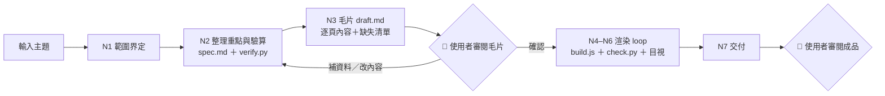

# Sabermetrics Player Evaluation Lab

用 Karpathy 的「LLM Wiki」模式整理**賽伯計量學球員評估**的知識庫：使用者挑選來源、提出問題，LLM 負責摘要、交叉連結、驗算與維護。內文為繁體中文，檔名為英文 kebab-case。

## 目前內容

| 類別 | 數量 | 例子 |
|---|---|---|
| 指標頁 `wiki/metrics/` | 13 | wOBA、wRAA、wRC、wRC+、Batting Runs、BsR、UZR、DRS、FIP、RE24、WAR（總覽、野手、投手） |
| 概念頁 `wiki/concepts/` | 6 | 得分期望值矩陣、Linear Weights、Park Factor、替補水準、RPW、守位調整 |
| 來源摘要 `wiki/sources/` | 16 | FanGraphs Library 各指標說明、WAR 方法更新公告 |
| 計算範例 `wiki/examples/` | 4 | Trout 2012 wRC+、Trout 2012 WAR、Trout 2013 wOBA、wOBA 權重推導 |
| 教學簡報 `outputs/slides/` | 2 | 《從 wOBA 到 wRC+》（23 頁）、《WAR 是怎麼算出來的》（19 頁） |

每個指標頁都包含完整推導（例如 wOBA 權重 → wRAA → wRC → wRC+），公式以 LaTeX 撰寫；來源說法不一致時並列呈現，並標註出處與時間。

## 資料夾結構

```
AGENTS.md        規則文件（schema）：結構、格式、命名、匯入與矛盾處理規則
SOP.md           標準作業流程：SOP-01 匯入文章 … SOP-04 主題 → 簡報 … SOP-06 交付
SUBMISSION.md    課程作業的六項繳交內容
raw/             原始來源（內容唯讀）
  articles/      文章 PDF（YYYY-MM-DD_<site>_<title>.pdf）
  data/          數據 CSV ＋ .meta.md（來源、轉換方式、檢查結果）
wiki/            LLM 維護的知識庫（Obsidian vault）
  index.md       全部頁面的目錄
  log.md         每次匯入、查詢、產出的紀錄
  dashboard.md   Dataview 動態查詢
outputs/slides/  教學簡報：<slug>.html（成品）＋ <slug>/（規格、驗算、毛片、執行紀錄）
scripts/slides/  簡報的建置與檢查工具
```

## 如何使用

**閱讀 wiki**：用 [Obsidian](https://obsidian.md/) 開啟整個資料夾，安裝 Dataview 外掛即可使用 `wiki/dashboard.md` 的查詢；頁面之間以 `[[wikilink]]` 連結。

**看簡報**：直接用瀏覽器開啟 `outputs/slides/*.html`（單一檔案、可離線），方向鍵或空白鍵換頁。

**重建簡報**：

```bash
cd scripts/slides && npm install && cd ../..
node scripts/slides/build.js outputs/slides/war-explained/src.html outputs/slides/war-explained.html
pip install playwright && python3 -m playwright install chromium
python3 scripts/slides/check.py outputs/slides/war-explained.html --shots /tmp/shots
```

**重跑數字驗算**：

```bash
python3 outputs/slides/war-explained/verify.py
python3 scripts/slides/spec_check.py outputs/slides/war-explained
```

## 簡報的產出流程（SOP-04 v1.2）



- **先交毛片、確認後才渲染**：`content_approved` 只有在使用者確認後才會設為 `true`，否則 `build.js` 拒絕建置。
- **每個數字都要驗算**：`verify.py` 重算簡報上的每一個數字並和原始資料比對；簡報上的數字標有資料位置代碼（例：`VAL·12·Batting`）。
- **回饋寫成規則**：同一種錯誤出現兩次，就寫進 `SOP.md` 的版面規則，並盡量改由程式檢查。

完整的一次執行紀錄見 `outputs/slides/war-explained/run-log.md`。

## 來源與授權

- `wiki/` 的頁面是依來源改寫的摘要與推導，引用處都標明出處；作者自己的推論以「推論」標示。
- `raw/` 收錄的文章 PDF 與數據來自 FanGraphs 等網站，著作權屬原作者與網站，僅供個人學習與研究使用。
