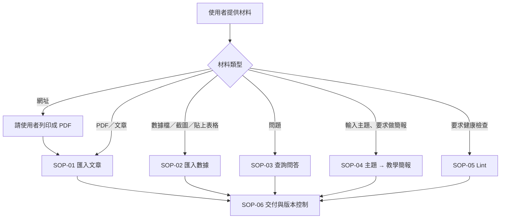
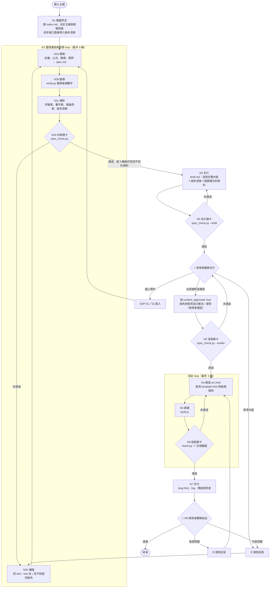

# SOP — Sabermetrics Player Evaluation Lab 作業流程

> 版本：v1.2（2026-11-23）
> 本文件把實際操作過的流程寫成標準步驟。**規則**以 `AGENTS.md` 為準，本文件說明**操作順序**；兩者衝突時，以 `AGENTS.md` 為準，並修正本文件。

---

## 0. 角色與共通原則

| 角色 | 負責 |
|---|---|
| **使用者** | 提供來源與數據、在檢查點做決定、執行 git commit |
| **Agent** | 存檔與命名、閱讀與摘要、驗算、寫入 wiki、製作輸出、記錄 log |

共通原則：
1. **先存檔，再處理**：所有來源都先進 `raw/`，wiki 只引用 `raw/` 中的檔案。
2. **數字一律驗算**：用程式重算，不憑記憶寫入；推論與來源說法分開標示。
3. **缺失一次說完**：每次報告都附「缺失清單」，不分次追問。
4. **每個動作都記錄**：完成後在 `wiki/log.md` 追加一筆紀錄。
5. **人工檢查點不可跳過**：標示 🛑 的步驟，必須等使用者回覆才能繼續。

---

## 1. 總覽



| SOP | 觸發條件 | 主要產出 |
|---|---|---|
| 01 匯入文章 | 使用者給網址或 PDF | `raw/articles/*.pdf`、來源頁、更新後的指標與概念頁 |
| 02 匯入數據 | 使用者給數據檔、截圖或表格 | `raw/data/*.csv` + `.meta.md`、更新後的範例頁 |
| 03 查詢問答 | 使用者提問 | 對話中的回答（必要時存成 wiki 頁） |
| 04 主題 → 簡報 | 使用者輸入「做簡報：<主題>」 | 先交毛片 `draft.md`；確認後才產生 `<slug>.html` |
| 05 Lint | 使用者要求檢查 | 檢查報告，經同意後批次修正 |
| 06 交付 | 每個 SOP 結束時 | 檔案存回資料夾、log 紀錄、commit 指令 |

---

## SOP-01 匯入文章

**輸入**：網址或 PDF　**輸出**：`raw/articles/` 中的 PDF、wiki 頁面更新

### 步驟

| # | 步驟 | 做法 | 完成條件 |
|---|---|---|---|
| 1 | 取得 PDF | 網址：先嘗試自行存成 PDF；不行就請使用者在瀏覽器按 Cmd + P →「另存為 PDF」 | `raw/articles/` 中有 PDF |
| 2 | 改名 | 依 `YYYY-MM-DD_<網站>_<短標題>.pdf` 改名（日期用文章發表日） | 檔名符合規則，舊名 → 新名已記下 |
| 3 | 抽取文字 | `pdftotext -layout`；去掉側欄、推薦文章等雜訊；確認頁數完整 | 全文可讀、沒有缺頁 |
| 4 | 決定模式 | 重要文章、論文、逐字稿 → **討論模式**；數據、短文 → **批次模式**；不確定 → 討論模式；使用者指定則依指定 | 模式已決定 |
| 5 | 驗算 | 文章中的範例數字，用程式重算；能用 `raw/data/` 交叉驗證的就驗證 | 每個數字標記「✓ 吻合」、「✗ 不符」或「無法驗算」 |
| 6 | 🛑 報告（討論模式） | 依 [附錄 A](#附錄-a報告模板) 的格式報告：重點、驗算結果、分歧、預計改動、**缺失清單** | 使用者回覆 |
| 7 | 寫入 wiki | 依 `AGENTS.md` 第 8 節的模板：來源頁 → 指標／概念頁 → 範例頁；分歧依第 10 節並列 | 所有預計改動都已完成 |
| 8 | 結構檢查 | 檢查 wikilink 是否指向存在的頁面、`$$` 是否成對、frontmatter 的 `source_count` 是否與 `sources` 一致 | 沒有錯誤（紅連結可以存在，但要記在 log） |
| 9 | 更新索引 | `index.md`、`overview.md`（需要時）、`log.md` | 三者都已更新 |
| 10 | 交付 | 進入 SOP-06 | — |

### 分支
- **文章需要的數據不在 `raw/`** → 在缺失清單列出「必要／選擇性」，寫明球員、聯盟、球季、欄位與匯出位置。
- **與既有頁面矛盾** → 並列兩方說法、標註來源與時間，frontmatter 加上 `contested` 或 `needs-review`。
- **發現之前的推論有誤** → 修正相關頁面，並在 log 寫明「修正：原本 → 現在」。

---

## SOP-02 匯入數據

**輸入**：CSV、XLSX、PDF 截圖或貼上的表格　**輸出**：`raw/data/*.csv` + `.meta.md`

| # | 步驟 | 做法 | 完成條件 |
|---|---|---|---|
| 1 | 保留原檔 | 原始檔案存入 `raw/data/`，例如 `fangraphs_mlb_2026-11-23_trout-player-page.pdf` | 原檔已保存 |
| 2 | 解析 | 依欄位位置解析；只保留需要的範圍（例如只取 MLB 例行賽，排除預測與 Total） | 每列欄位數一致 |
| 3 | 處理有歧義的欄位 | 對不齊、無法確定的欄位**不收錄**，在 meta 中說明原因與替代來源 | 沒有猜測的數值 |
| 4 | 交叉檢查 | 例如：1B + 2B + 3B + HR = H、H ÷ AB = AVG、重算 OBP、各組成加總 = 合計 | 全部通過；不通過的列要回頭查 |
| 5 | 輸出 | UTF-8 CSV，檔名 `<來源>_<聯盟>_<球季>_<主題>.csv`，欄位名沿用來源原名 | CSV 可被讀取 |
| 6 | 寫 meta | 同名 `.meta.md`：來源網址、擷取日期、提供方式、範圍、欄位說明、清理步驟、檢查結果 | meta 已建立 |
| 7 | 回填 wiki | 用新數據補完「待查證」的範例，狀態改為 `stable` | 範例數字已驗證 |
| 8 | 交付 | 進入 SOP-06 | — |

---

## SOP-03 查詢問答

| # | 步驟 | 做法 |
|---|---|---|
| 1 | 找頁面 | 先讀 `index.md`，再讀相關頁面；必要時回到 `raw/` 原文確認 |
| 2 | 回答 | 引用 wiki 頁面；區分「來源說法」與「推論」；需要時用假設數字示範，並註明是假設 |
| 3 | 驗算 | 回答中出現的計算，都用程式重算 |
| 4 | 回寫 | 回答過程中發現 wiki 的缺漏或錯誤（例如待確認事項、原文筆誤），直接補進對應頁面 |
| 5 | 詢問是否存頁 | 回答有長期價值時（比較、推導、案例），問使用者要不要存成新頁 |
| 6 | 記錄 | `log.md` 追加 `query` 紀錄 |

連續追問同一主題時，可以合併成一筆 log。

---

## SOP-04 主題 → 教學簡報（graph）

**觸發**：使用者輸入「做簡報：<主題>」或類似要求。
**核心原則：先交毛片，確認後才渲染。** 渲染前只交付「毛片」：每頁要呈現的完整內容，加上缺失清單和需要補充的資料。使用者補齊資料、確認內容後，才開始製作渲染後的簡報。這一點由程式強制：`spec.md` 的 `content_approved` 不是 `true` 時，`build.js` 會拒絕建置。

### 流程圖



### 節點說明

| 節點 | 輸入 | 輸出（狀態） | 通過標準 | 未通過時 |
|---|---|---|---|---|
| **N1 範圍界定** | 主題、`wiki/index.md` | 主線、相關頁面清單（寫進 spec.md 開頭）、初步缺口 | — | **不停下**：缺口直接帶入缺失清單，在毛片中一次告知 |
| **N2a 擷取** | 相關 wiki 頁、`raw/data/` | `spec.md`：頁面規劃、符號表、數字表 | — | — |
| **N2b 驗算** | 數字表 | `verify.py`：每個數字一行斷言 | `verify.py` exit 0 | 回 N2e |
| **N2c 補齊** | spec.md | 推論清單、缺失清單、每個數字的出處代碼 | — | — |
| **N2d 內容關卡** | spec.md、verify.py | `spec_check.py` 報告 | 符號都有定義與出處；數字都有出處，驗算為 ✓ 或「無法驗算（原因）」；verify.py 通過。**允許有未解決的缺失**，會帶進毛片 | 回 N2e；**最多 3 輪**，仍找不到的資料寫進缺失清單後進 N3 |
| **N3 毛片** | spec.md | `draft.md`（依 `scripts/slides/draft_template.md`）：逐頁完整內容、缺失清單、需要補充的資料（含取得方式）、確認欄 | `spec_check.py --draft`：頁面規劃的每一頁都有內容；缺失清單與需要補充的資料兩節都在 | 補齊毛片 |
| **使用者審閱毛片** 🛑 | draft.md | 使用者的回饋或資料 | 使用者勾選確認欄三項 | 補資料 → SOP-01／02 → N2；改內容 → R → N2 |
| **確認** | 使用者的確認 | `content_approved: true`；缺失狀態改為「已解決」或「接受（使用者確認）」 | — | — |
| **N4 渲染關卡** | spec.md、draft.md | `spec_check.py --render` 報告 | 已確認；每一筆缺失都已解決或經使用者接受 | 回使用者審閱 |
| **N4 撰寫** | 已確認的 draft.md、`template.html` | `src.html` | 內容與毛片一致；**不可新增毛片以外的數字**（要新增就回 N2，並重新確認） | — |
| **N5 建置** | src.html | `<slug>.html`（單一檔案、可離線） | 已確認；公式錯誤 = 0；版面規則錯誤 = 0（例：禁用 `\tfrac`） | 回 N4 |
| **N6 版面關卡** | `<slug>.html` | `check.py` 報告＋每頁截圖 | 溢出 = 0、殘留公式錯誤 = 0、像素字體中文 = 0、每頁都有標題；重點頁目視無重疊 | 回 N4；**最多 3 輪** |
| **N7 交付** | 成品 | 存回資料夾、`log.md`、傳檔給使用者 | — | — |
| **N8 審閱成品** 🛑 | 使用者回饋 | — | 使用者滿意 | 版面問題 → R → N4；內容問題 → R → N2（需重新確認毛片） |
| **R 規則回寫** | 回饋 | 新規則（版面規則、AGENTS.md、spec 的 Loop 紀錄） | — | 回到對應節點 |

### 為什麼這樣設計
- **內容和渲染分開確認**：過去的修改大多是內容問題（定義不足、缺計算方式、數字錯）。先用毛片把內容談定，渲染只處理版面，就不必為了改一句話重做整份簡報。
- **缺失一次說完**：N1 和 N2 找不到的東西不中途停下來問，全部集中在毛片的缺失清單和「需要補充的資料」，連同取得方式一次交給使用者。
- **確認由程式強制**：`content_approved` 沒有變成 `true`，`build.js` 就拒絕建置；`spec_check.py --render` 也會檢查每一筆缺失都已解決或經使用者接受。
- **關卡用程式判斷、每個 loop 都有上限**：數字、符號、頁數、版面都有客觀標準；loop 最多 3 輪，超過就交給人。
- **回饋一定回寫成規則（R）**：同樣的問題下次在更前面的節點就被擋下。

### 檔案與指令

每份簡報一個工作資料夾：
```
outputs/slides/
├── <slug>.html          ← 成品（使用者確認毛片後才產生）
└── <slug>/
    ├── spec.md          ← N2 狀態檔（含 content_approved）
    ├── verify.py        ← N2b 數字斷言
    ├── draft.md         ← N3 毛片（交給使用者審閱）
    ├── src.html         ← N4 原始檔
    ├── run-log.md       ← 逐節點執行紀錄（選用）
    └── shots/           ← N6 截圖（不納入 git）
```

第一次使用（在專案根目錄）：
```bash
cd scripts/slides && npm install && cd ../..
pip install playwright && python3 -m playwright install chromium
```

各關卡指令：
```bash
python3 scripts/slides/spec_check.py outputs/slides/<slug>/            # N2d 內容關卡
python3 scripts/slides/spec_check.py outputs/slides/<slug>/ --draft    # N3 毛片關卡
python3 scripts/slides/spec_check.py outputs/slides/<slug>/ --render   # N4 渲染關卡
node    scripts/slides/build.js outputs/slides/<slug>/src.html outputs/slides/<slug>.html        # N5
python3 scripts/slides/check.py outputs/slides/<slug>.html --shots outputs/slides/<slug>/shots   # N6
```
所有指令都是**通過回傳 0、未通過回傳 1**，可以直接當作 loop 的判斷條件。

### 版面規則（累積自 v1–v3 的修改）
- **先畫流程圖，再講細節**；流程圖的每個步驟，寫成**箭頭上的標籤節點**：第一行灰色小字寫步驟編號，下面每個運算各占一行，運算符號對齊。橫向空間不足就改成多列或直向。
- **避免列點**：大綱、限制等頁面用模組面板或流程呈現。
- **每個符號都要有定義**：公式裡的變數，第一次出現時在公式下方用定義框說明（例：lgwOBA、lgR/PA、n_x）。對應 spec.md 的符號表。
- **比較用表格**：例如 wRAA 和 wRC 的比較。
- **重要提醒要醒目**：用黃色警示框，不要藏在小字備註裡。
- **範例前先放原始數據表**，每個數字標上資料位置代碼（例：`STD·13·BB` = standard.csv 中 2013 年那一列的 BB 欄）；聯盟常數標 `GUTS`，文章數字標 `ART·…`。對應 spec.md 的數字表。
- **風格**：80 年代復古（早期電腦 × 街機像素）＋少量 Y2K。像素字體**只用在英文標籤與數字**；中文一律用無襯線字體（在像素字體區塊中，中文要包 `.zh`）。check.py 會自動檢查。
- **流程圖標籤的框要夠大**：箭頭標籤（foreignObject）的寬高不足時，文字會被裁掉，而不是溢出投影片。war-explained 的 P.4 發生過，已由 `check.py` 的 `fo_clip` 自動檢查。
- **推論要標示**：簡報中的推論和來源說法一樣，要註明「推論」。對應 spec.md 的推論清單。
- **分數用 `\dfrac`，不用 `\tfrac`**：`\tfrac` 在投影片上字太小。兩份簡報的 v1 都犯過，已改由 `build.js` 自動擋下。
- **撰寫時新增的數字，要先回 N2 補進規格**：N4 不可以出現數字表裡沒有的數字（war-explained 執行時發生過）。

### 範例
- `outputs/slides/woba-to-wrc-plus/`：v3 的 spec.md（17 個符號、19 筆數字）、verify.py（29 項斷言全部通過）、src.html；spec_check 與 check.py 皆通過。
- `outputs/slides/war-explained/`：第一次從主題完整跑完 graph（v1.1 流程，當時尚無毛片節點），含逐節點的 `run-log.md`；`content_approved: false`，日後回來時先補毛片。

---

## SOP-05 檢查（Lint）

使用者要求時執行，項目依 `AGENTS.md` 第 11.3 節。

| # | 步驟 | 做法 |
|---|---|---|
| 1 | 結構檢查 | 紅連結、孤立頁面、`$$` 不成對、frontmatter 缺欄位、`source_count` 不一致 |
| 2 | 內容檢查 | 數值沒標聯盟與年份、公式沒用 LaTeX、指標頁缺推導段落、待確認事項是否有新來源可以解決 |
| 3 | 🛑 報告 | 列出問題與建議的修正、可以補的來源 |
| 4 | 修正 | 使用者同意後批次修正 |
| 5 | 記錄 | `log.md` 追加 `lint` 紀錄 |

---

## SOP-06 交付與版本控制

| # | 步驟 | 做法 |
|---|---|---|
| 1 | 存回資料夾 | 所有新增或修改的檔案寫回使用者的專案資料夾；寫入前確認檔案沒有在其他地方被修改 |
| 2 | 記錄 | `log.md` 追加一筆，格式 `## [YYYY-MM-DD] 類型 \| 標題`，類型為 `setup`、`ingest`、`query`、`lint`、`schema`、`output` 之一 |
| 3 | 回報 | 告訴使用者：做了什麼、驗算結果、缺失清單、下一步建議 |
| 4 | 🛑 Commit | 提供指令，由使用者在 Terminal 執行（Agent 的連線環境不能刪除 git 鎖定檔，所以不代為 commit） |

```bash
cd ~/Desktop/"Sabermetrics Player Evaluation Lab"
git status
git add -A && git commit -m "<類型>: <簡述>"
```

---

## 附錄 A：報告模板

```markdown
## 重點
1. …（3～7 點，用自己的話改寫）

## 驗算結果
| 項目 | 計算 | 來源數字 | 結果 |
|---|---|---|---|

## 來源之間的分歧
- …（並列，不下結論）

## 預計的改動
| 動作 | 頁面 |
|---|---|

## 缺失清單
| 類別 | 項目 | 重要性 |
|---|---|---|
| 缺少的推導或解釋 | … | 必要／選擇性 |
| 缺少的數據 | 球員／聯盟／球季／欄位／匯出位置 | 必要／選擇性 |
| 無法驗證的數字 | … | 必要／選擇性 |
| 待確認的問題 | … | 必要／選擇性 |
| 建議的下一份來源 | … | — |
```

## 附錄 B：命名規則速查

| 類型 | 規則 | 例 |
|---|---|---|
| 文章 PDF | `YYYY-MM-DD_<網站>_<短標題>.pdf` | `2014-07-30_fangraphs_re24.pdf` |
| 數據 CSV | `<來源>_<聯盟>_<球季>_<主題>.csv` | `fangraphs_mlb_2011-2026_trout-standard.csv` |
| 來源頁 | `src-<年>-<作者>-<短標題>.md` | `src-2014-weinberg-fangraphs-re24.md` |
| 範例頁 | `ex-<指標>-<聯盟>-<年>-<主題>.md` | `ex-wrc-plus-mlb-2012-trout.md` |
| 簡報 | `outputs/slides/<主題>.html` | `woba-to-wrc-plus.html` |

## 附錄 C：常見狀況

| 狀況 | 處理 |
|---|---|
| Agent 連不上網站，無法存 PDF | 請使用者在瀏覽器列印成 PDF |
| 使用者說附了檔案，但沒有收到 | 檢查 `raw/` 資料夾；都沒有就請使用者重新提供 |
| PDF 表格欄位對不齊 | 不收錄有歧義的欄位，在 meta 說明，建議改從網站匯出 CSV |
| 驗算和來源數字不符 | 先檢查四捨五入與常數版本；仍不符就在頁面標 `needs-review`，並列入缺失清單 |
| 使用者關掉 Terminal | 重新開啟後先 `cd` 回專案資料夾；檢查 `.git` 中有沒有殘留的 `index.lock` |

---

## 修訂紀錄
- v1.2（2026-11-23）：SOP-04 改為「先交毛片、確認後才渲染」：新增 N3 毛片（draft.md）與使用者確認關卡；N1 不再中途停下；spec_check.py 新增 --draft、--render 模式；build.js 未確認時拒絕建置。
- v1.1（2026-11-23）：SOP-04 改寫為 graph，「整理重點與驗算」獨立為 loop；建置與檢查腳本存入 `scripts/slides/`（build.js、check.py、spec_check.py、template.html）。
- v1.0（2026-11-23）：依建立專案、匯入 wOBA 至 WAR 共 10 篇文章、Trout 數據、簡報 v1–v3 的實際流程整理。
